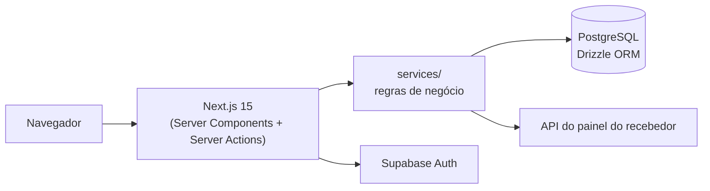

# Estoque de Maquininhas (POS) · Case

Sistema web de gestão de estoque de maquininhas de cartão, construído para a
equipe de operações de uma sub-adquirente e integrado à API do painel do
recebedor de pagamentos.

> 🔒 **Código privado.** Este repositório apresenta o case: problema, solução,
> arquitetura e decisões técnicas. Nenhum código, dado ou credencial da empresa
> está publicado aqui.

---

## 📌 O problema

O estoque de maquininhas era controlado numa planilha. O vínculo entre a máquina
física e o cliente era feito à parte, direto no painel do recebedor, e por isso
o estoque e o painel divergiam com frequência. Era difícil responder perguntas
básicas:

- Com qual cliente está essa máquina hoje? E com quem estava antes?
- Quantas máquinas estão em estoque, em reparo ou perdidas?
- Quais máquinas saíram para eventos e ainda não voltaram?
- Quem fez cada alteração?

## 🔄 Evolução

1. **Planilha automatizada.** Primeiro melhorei a planilha existente, com
   importação das bases exportadas do próprio painel do recebedor.
2. **Aplicação web (v1).** Com o processo validado, criei a primeira versão:
   front-end em Next.js, API em Python/FastAPI e banco no Supabase.
3. **Arquitetura unificada (v2).** Migrei tudo para um único projeto Next.js.
   As regras de negócio passaram para uma camada de serviços no servidor, o
   que eliminou a API separada, o CORS e o segundo processo de deploy.

## ✅ Funcionalidades

- **Máquinas:** cadastro unitário e em lote, com classificação automática do
  modelo pelo prefixo e pelo tamanho do número de série. Estados `NO CLIENTE`,
  `ESTOQUE`, `REPARO` e `MÁQUINA PERDIDA`. Aquisição comprada ou alugada e
  operadora do chip.
- **Vínculo máquina ↔ cliente pelo estoque:** o vínculo é feito pelo sistema,
  que conversa com a API do painel do recebedor antes de gravar. Se a chamada
  remota falha, a máquina fica como estava, e o estoque continua sendo a única
  fonte da verdade.
- **Vínculo em lote:** até 500 números de série por vez, com validação item a
  item e relatório de recusas (repetido, não cadastrado, sem permissão etc.).
- **Clientes:** sincronização com o painel do recebedor (upsert pelo MID),
  bloqueio de vínculo para cliente inativo e valor de aluguel por máquina.
- **Eventos:** saída de lotes de máquinas para eventos, com datas de início e
  fim. A situação (ABERTO, PENDENTE, FINALIZADO) é calculada no fuso de São
  Paulo, e um aviso aparece quando há devolução pendente.
- **Parceiros e distribuidores:** controle de máquinas cedidas a parceiros e da
  origem de cada equipamento.
- **Movimentações:** histórico completo de cada máquina (vínculo, desvínculo,
  entrada e saída de evento, exclusão), sempre com o usuário responsável.
  Resumo semanal por cliente que compensa entradas e saídas, e exportação.
- **Painel:** totais, gráfico de máquinas por modelo e estado, e movimentações
  da semana.
- **Usuários e permissões:** perfis ADMIN, OPERACIONAL e COMERCIAL, com
  permissões individuais (desvincular máquina, alterar estoque, ver e baixar
  movimentações, gerir usuários).

## 🏗️ Arquitetura

- **Leituras** em Server Components e **mutações** em Server Actions. Route
  Handlers só onde são necessários: login, sincronização, buscas e download.
- **Regra fixa:** nenhuma regra de negócio em actions ou handlers. São cascas
  finas (autenticar → validar com Zod → chamar o serviço → revalidar), e toda
  a lógica fica em `services/`.
- **Pronto para serverless:** nenhum estado fica em memória entre requisições.
  O lock da sincronização, o rate limit do login e o bloqueio temporário da API
  externa ficam no banco.
- **Sincronização resumível:** como a hospedagem limita cada resposta a cerca
  de 30 s, a sincronização processa páginas dentro de um orçamento de tempo,
  grava o progresso e continua na chamada seguinte.
- **Integridade também no banco:** CHECKs, triggers e índices únicos no
  PostgreSQL reforçam as regras da aplicação.

## 🔐 Segurança

- Sessão em cookies httpOnly; o token nunca chega ao JavaScript.
- JWT validado no servidor via JWKS (ES256/RS256).
- Acesso só para usuários provisionados por um administrador.
- Rate limit de login por IP.
- Autorização checada em toda action e handler, não só na interface.
- Logout por inatividade e validade máxima de sessão.
- Erros inesperados nunca expõem detalhes internos.
- Headers de segurança (CSP, HSTS) e varredura de segredos (gitleaks) no
  pre-commit.

## 🧪 Qualidade

| Indicador | Valor |
| --- | --- |
| Testes automatizados | 1.262 em 78 arquivos |
| Cobertura (`services/` + `lib/`) | 98,5% de linhas · 91,6% de branches |
| Avisos de ESLint | 0 |

- **Unitários:** regras de serial, permissões, cálculo semanal de
  movimentações, filtros e componentes.
- **Integração:** rodam contra PGlite (Postgres em memória) com as migrações
  reais aplicadas, então triggers e CHECKs também são testados. As APIs
  externas são simuladas com msw.
- **E2E:** smoke com Playwright (login, telas do menu, logout).
- **Gate único** (`tsc` + ESLint + Prettier + Vitest) no pre-commit, no CI e no
  build de deploy.
- **Migrações versionadas** com Drizzle, incluindo um script de cutover que
  verifica o banco existente antes de aplicar qualquer mudança.

## 🛠️ Stack

| Camada | Tecnologias |
| --- | --- |
| Front-end e back-end | Next.js 15 (App Router), React 19, TypeScript (strict) |
| Estilo | Tailwind CSS 4, tema claro e escuro |
| Banco | Supabase (PostgreSQL), Drizzle ORM |
| Autenticação | Supabase Auth, `@supabase/ssr`, `jose` |
| Validação | Zod |
| Gráficos | Recharts |
| Testes | Vitest, PGlite, msw, Testing Library, Playwright |
| Qualidade e CI | ESLint, Prettier, gitleaks, GitHub Actions, Dependabot |
| Hospedagem | Configurado para AWS Amplify |
| v1 (legado) | Python, FastAPI, Alembic |

## 💡 O que aprendi

- Transformar um processo de planilha num sistema com uma única fonte da
  verdade.
- Integrar com uma API externa de pagamentos. Usei agentes de IA para analisar
  a documentação e extrair só os endpoints e fluxos necessários.
- Migrar uma arquitetura de dois serviços (Next.js + FastAPI) para um projeto
  unificado, sem perder regras de negócio.
- Projetar para serverless: estado no banco, operações resumíveis e limites de
  tempo de resposta.
- Montar uma base de testes que exercita o banco de verdade, não só mocks.

## 🖼️ Telas

<!-- Adicione aqui prints com dados fictícios, ex.:  -->

---

Desenvolvido por **[Vitor Boarreto](https://github.com/Boarreto)**.
